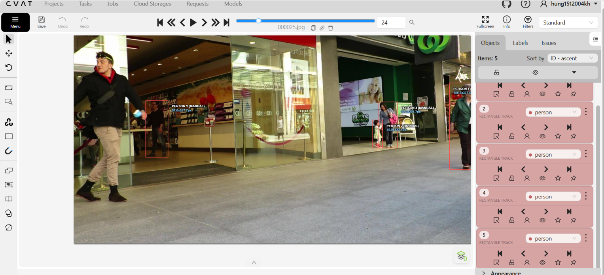
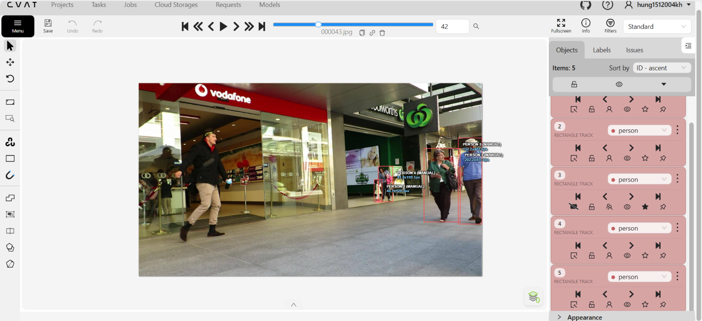
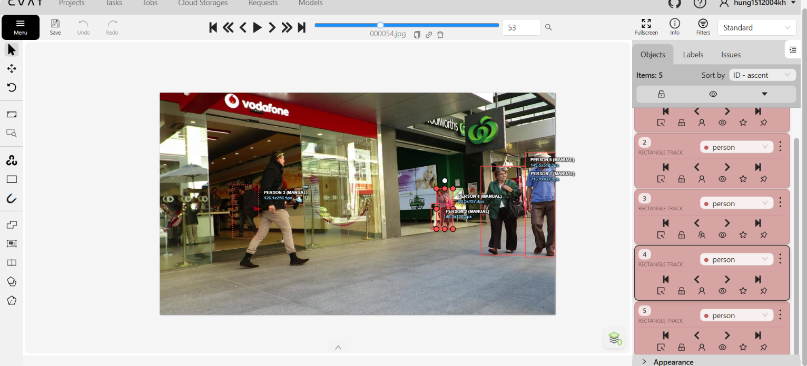

# Báo cáo cá nhân — NguyenKhaiHung-2A202603316

Đoạn video: MOT17-09, 150 frame (frame 1–150), nguồn MOTChallenge, giấy phép CC BY-NC-SA 3.0.

## 0. Thông tin học viên

- Họ tên: Nguyễn Khải Hưng
- MSSV: 2A202603316
- Mã đề (A/B/C): B
- Email: hung1512004kh@gmail.com
- Link repository: (https://github.com/NKHung151/K5-L2B-DAY05-NguyenKhaiHung-2A202603316-MOTTracking)
- Giờ bắt đầu: 16h25
- Giờ kết thúc: 19h15

## 1. Xem trước đoạn video (CP0)

Ghi **trước khi vẽ**, mỗi người một dòng.

| Mã | Frame xuất hiện | Frame cuối thấy được | Rẽ / dừng / đổi tốc độ ở frame | Bị che ở frame | Ghi chú |
|---|---|---|---|---|---|
| P1 (bà áo khoác xanh lá) | 0 | 149 | Đi ngang qua camera, không rẽ, không dừng | Không bị che | |
| P2 (bé gái) | 0 | 146 | Đi bình thường và dừng lại ở khoảng frame thứ 30 | 105–110 và 135–146 (`occluded`); 111–134 khuất hẳn (`outside`) | Bị bà áo xanh lá che; `outside` từ frame 147 |
| P3 (người trong cửa hàng Vodafone) | 0 | 149 | Từ frame thứ 60 đổi hướng tiến về phía camera với tốc độ bình thường nên box không di chuyển nhiều | 26–41 và 44–54 (`occluded`); 42–43 khuất hẳn (`outside`) | Bị người áo đen đi ngang phía trước che |
| P4 (người mẹ) | 0 | 140 | Đi bình thường và dừng lại ở khoảng frame thứ 30 | 90–106 và 125–140 (`occluded`); 107–124 khuất hẳn (`outside`) | Bị bà áo xanh lá che; `outside` từ frame 141 |
| P5 (ông áo xanh lam đội mũ) | 0 | 149 | Đi ngang qua camera, không rẽ, không dừng | Không bị che | Ở frame 0 chỉ lộ một phần ở mép phải khung hình |

## 2. Keyframe và thời gian (CP1, CP4)

Số keyframe lấy từ kết quả `src/check_submission.py`. Tên người theo tên object trên CVAT: P1 = track CVAT 0, P2 = track 1, P3 = track 2, P4 = track 3, P5 = track 4.

| Mã | Số keyframe | Keyframe ở frame | Số frame có mặt | Keyframe / 100 frame | Thời gian (phút) | Chỗ khó |
|---|---|---|---|---|---|---|
| P1 | 15 | 0, 10, 28, 29, 30, 50, 60, 70, 80, 100, 110, 123, 130, 140, 149 | 150 | 10,0 | 5ph | |
| P2 | 15 | 0, 6, 10, 20, 40, 50, 60, 70, 80, 100, 105, 110, 135, 140, 143 | 123 | 12,2 | 20ph | Phân vân không biết gán `occluded` hay `outside` |
| P3 | 20 | 0, 10, 20, 26, 30, 40, 44, 50, 55, 62, 73, 84, 94, 104, 112, 120, 130, 140, 143, 149 | 148 | 13,5 | 20ph |Phân vân không biết có nên gán `occluded` khi tay bị bàn che hay không. |
| P4 | 21 | 0, 4, 10, 20, 25, 30, 40, 44, 50, 55, 60, 75, 80, 85, 90, 96, 100, 105, 125, 132, 136 | 123 | 17,1 | 10ph |Giống P2 |
| P5 | 17 | 0, 3, 10, 20, 30, 40, 50, 60, 70, 80, 90, 100, 110, 120, 130, 140, 149 | 150 | 11,3 | 10ph | |
| **Tổng** | 88 | | 694 | | 65ph | |

Keyframe / 100 frame của cả bài = tổng keyframe ÷ tổng số frame có mặt × 100 = 88 ÷ 694 × 100 = 12,7.

Bạn đặt keyframe nhiều nhất ở người nào? Vì sao (người đó rẽ, dừng, lại gần camera hay bị che)?

P4 (người mẹ) có nhiều keyframe nhất, 21 keyframe, vì bị che nhiều lần. Ban đầu P4 chỉ bị che một phần (`occluded` từ frame 90 đến 106). Sau đó bị che hẳn nên bật `outside` (frame 107–124). Khi hiện lại từ frame 125, P4 chỉ lộ một phần rồi tiếp tục bị che (`occluded` frame 125–140). Ở các đoạn này vị trí của P4 phải ước lượng, nên tôi đặt thêm keyframe ở chỗ đổi trạng thái (frame 90–96, 105, 125, 132, 136) để box không trôi.

## 3. Đoạn bị che (CP2)

Người bị che: `P3` theo tên object trên CVAT của tôi (người đàn ông trong cửa hàng Vodafone, là P1 trong ảnh nhận diện đề B), bị người áo đen quần kaki đi ngang phía trước che. Người áo đen này không thuộc 5 người được giao nên không gán nhãn.

| Mốc | Frame |
|---|---:|
| Bắt đầu bị che một phần (bật `occluded`) | 26 |
| Mất hẳn (bật `outside`) | 42 |
| Hiện lại (tắt `outside`) | 44 |
| Thấy rõ trở lại (tắt `occluded`) | 55 |

- Thời gian khuất hẳn: 2 frame (42–43) = 0,07 giây.
- Quyết định: giữ cùng ID (track CVAT 2, không tạo track mới).
- Lý do (trả lời 3 câu: khuất bao lâu so với 60 frame, ngoại hình có khớp, chỗ hiện lại có đúng hướng và tốc độ):

Khuất hẳn chỉ 2 frame, rất ngắn so với ngưỡng 60 frame. Trước và sau đoạn che đều là một người mặc áo tối, quần jeans (kiểm lại ở frame 24 và frame 54). Người này đi tiến về phía camera với tốc độ bình thường nên box không di chuyển nhiều, vì vậy vị trí hiện lại (frame 44) gần vị trí trước khi bị che và đúng hướng, tốc độ cũ.

Ảnh chụp màn hình:





## 4. Tự review ID (CP3)

Lượt 1 theo người (đi ngược từ frame 149 về 0 trên CVAT), lượt 2 theo cảnh (nhảy 10 frame). Ít nhất 3 dòng; không có lỗi thì ghi một dòng "đã kiểm hai lượt, không lỗi".

Loại lỗi dùng đúng một trong 7 mã: `id_switch`, `fragmentation`, `lost`, `merge`, `false_track`, `drift`, `flag`.

| Frame | Mã người | Loại lỗi | Mô tả một câu | Phát hiện ở lượt | Đã sửa? |
|---:|---|---|---|---|---|
| Cả 149 → 0 và các bước 10 frame | P1–P5 | Không có | Đã kiểm hai lượt, không phát hiện lỗi | Lượt 1 và lượt 2 | Không có lỗi để sửa |

Tổng hợp số lỗi theo loại:

| `id_switch` | `fragmentation` | `lost` | `merge` | `false_track` | `drift` | `flag` |
|---:|---:|---:|---:|---:|---:|---:|
| 0 | 0 | 0 | 0 | 0 | 0 | 0 |

Lỗi nào chỉ lượt 2 (theo cảnh) mới thấy, lượt 1 (theo người) không thấy? Vì sao?

Không có lỗi nào. Sau hai lượt tôi không phát hiện lỗi ID ở lượt nào, nên không có lỗi chỉ xuất hiện ở lượt 2.

## 5. File xuất và kết quả tự kiểm (CP4)

| Kiểm tra | Kết quả |
|---|---|
| Tên file MOT 1.1 | `src/exports/NguyenKhaiHung_mot.zip` |
| Tên file CVAT for video 1.1 | `src/exports/NguyenKhaiHung_cvat_video.zip` |
| Số track ID khác nhau trong `gt/gt.txt` (phải là 5) | 5 |
| Frame `outside` không có dòng trong `gt.txt` (đúng / sai) | Đúng. Không có dòng nào ở các frame `outside` (số frame theo CVAT): P3 frame 42–43; P2 frame 111–134 và từ 147; P4 frame 107–124 và từ 141 |
| Job đã completed trên CVAT máy cá nhân | Đã completed |

Dán phần tóm tắt in ra từ `src/check_submission.py`:

```text
=== File MOT 1.1: NguyenKhaiHung_mot.zip ===
  Số track ID: 5   |   Tổng số box: 694
  [OK]        Đúng 5 track ID.

  Track | Frame có mặt | Số frame | Đoạn vắng (outside)
      1 |   0–149      |      150 | -
      2 |   0–146      |      123 | 111–134
      3 |   0–149      |      148 | 42–43
      4 |   0–140      |      123 | 107–124
      5 |   0–149      |      150 | -

=== File CVAT for video 1.1: NguyenKhaiHung_cvat_video.zip ===

  Track | Nhãn   | Frame thấy | Keyframe | KF/100 frame | Frame occluded | Lần bật outside
      0 | person |        150 |       15 |         10.0 |              0 |               0
      1 | person |        123 |       15 |         12.2 |             18 |               2
      2 | person |        148 |       20 |         13.5 |             27 |               1
      3 | person |        123 |       21 |         17.1 |             33 |               2
      4 | person |        150 |       17 |         11.3 |              0 |               0

  Tổng: 88 keyframe / 694 frame có mặt = 12.7 keyframe / 100 frame
  [OK]        Đọc được 5 track từ annotations.xml.

=== Tóm tắt ===
  Lỗi: 0   |   Cảnh báo: 0
  Đạt. Dán phần tóm tắt này vào báo cáo mục 5.
```

## 6. Ba câu kết

1. Nếu được gán lại, bạn sẽ đặt keyframe khác ở đâu? Vì sao?

   Lần gán đầu tiên tôi đặt quá nhiều keyframe (tổng 154, riêng P5 có 63, nhiều chỗ keyframe nằm liên tiếp từng frame), sau khi sửa còn 88 keyframe, khoảng 13 keyframe mỗi 100 frame. Nếu gán lại, tôi sẽ đặt keyframe thưa ở những đoạn đi thẳng đều, như P1 và P5 đi ngang qua camera, chỉ cần khoảng mỗi 10 frame rồi tua kiểm tra, và để nội suy làm phần còn lại. Tôi sẽ dồn keyframe vào những chỗ trạng thái thay đổi: với P3 là frame 26 (bắt đầu bị che), 42–44 (khuất hẳn rồi hiện lại) và 55 (thấy rõ trở lại), với P4 là frame 90, 107 và 125. Lý do là nội suy tuyến tính chỉ sai khi vận tốc đổi hoặc khi người bị che và vị trí phải ước lượng, còn ở đoạn đều thì keyframe dày chỉ tốn công và làm box dễ rung.

2. Có chỗ nào bạn không chắc "cùng ID hay ID mới"? Bạn đã quyết định và ghi chú thế nào?

   Có. Ở P2 (bé gái) và P4 (người mẹ) tôi phân vân giữa `occluded` và `outside` khi họ bị bà áo xanh lá che gần hết, và ở P3 tôi phân vân có nên gán `occluded` khi chỉ một phần cơ thể bị che hay không. Tôi chọn `outside` khi không còn thấy gì của người đó và `occluded` khi còn thấy một phần. P2 khuất hẳn 24 frame (111–134) và P4 khuất hẳn 18 frame (107–124), P3 chỉ khuất hẳn 2 frame (42–43), đều dưới ngưỡng 60 frame của lớp. Vì vậy tôi giữ cùng ID, tắt `outside` trên track cũ khi người đó hiện lại (P2 ở frame 135, P4 ở frame 125, P3 ở frame 44) thay vì tạo track mới. Tôi ghi lại các chỗ phân vân này ở cột "Chỗ khó" của mục 2.

3. Một lỗi ID trong job của bạn (nếu không còn sót, chọn lỗi đã sửa) có thể làm xe tự lái dự đoán sai chuyển động của người đó như thế nào? Lỗi đó ảnh hưởng MOTA hay IDF1 nhiều hơn?

   Lỗi dễ xảy ra nhất trong job của tôi là `id_switch` hoặc `fragmentation` ở P2 và P4 khi họ đi sát và bị bà áo xanh lá che: nếu khi họ hiện lại tôi tạo track mới, hoặc ID nhảy sang người che, thì một người sẽ bị tách thành hai ID. Với xe tự lái, đây là một em bé đi gần đường nên xe cần dự đoán đúng đường đi của em. Nếu ID nhảy sang người khác, vị trí của "cùng một đối tượng" đổi đột ngột trong một frame, nên vận tốc tính từ nhãn bị phóng đại rất lớn (ví dụ 1,5 m trong 1/30 giây tương đương khoảng 162 km/h), và xe có thể dự đoán sai hướng đi hoặc phanh không cần thiết. Còn nếu một người bị tách thành hai ID thì xe mất lịch sử chuyển động và phải dự đoán lại từ đầu. Lỗi này ảnh hưởng IDF1 nhiều hơn MOTA. MOTA chỉ đếm mỗi lần đổi ID là một lỗi IDSW nhỏ trong tổng số lỗi, còn IDF1 đo xem mỗi người có được giữ đúng một ID trong suốt đoạn thấy được hay không, nên một người bị tách thành hai ID bị trừ điểm trên toàn bộ đoạn còn lại.

## 7. Tài liệu tham khảo và công cụ AI đã dùng

- Tài liệu của lab: `README.md`, `RULES.md`, `CHECKPOINTS.md`, `docs/GUIDELINE.md`, `docs/CVAT_CHEATSHEET.md`, `docs/MOT_FORMAT.md`.
- Dữ liệu: MOT17, MOTChallenge (Milan et al., 2016), giấy phép CC BY-NC-SA 3.0.
- Công cụ AI: Claude hỗ trợ sửa câu văn khi viết báo cáo và soạn bản nháp mục 6 (Ba câu kết) từ thông tin job do tôi cung cấp, sau đó tôi tự đọc và chỉnh sửa.
